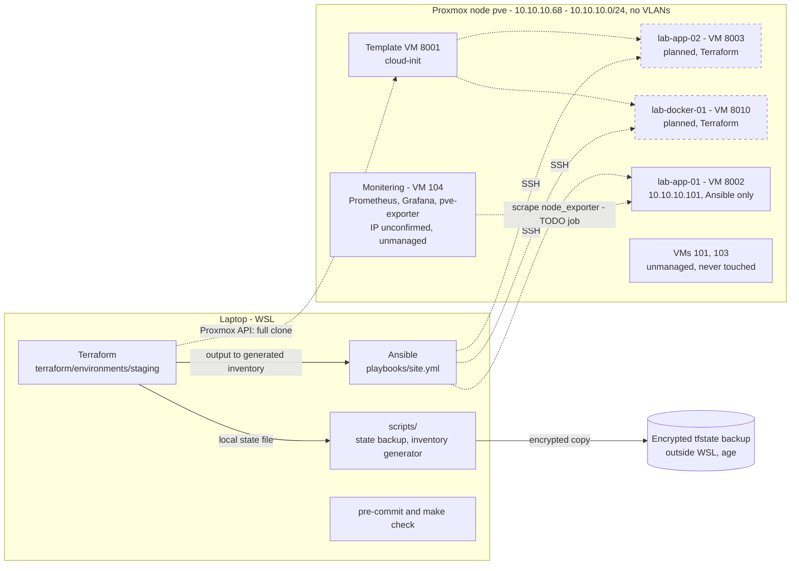

# Homelab Infrastructure as Code (Proxmox)

Terraform and Ansible for a single-node Proxmox homelab, with guard rails, quality gates and runbooks. Written
and validated offline; **not yet applied to the real server**.

## What this demonstrates

- **Terraform module design:** a reusable cloud-init VM module, a staging environment on top of it, typed
  variables with validation, pinned provider and Terraform versions, and outputs that feed Ansible.
- **Guard rails as code:** VM-ID range and protected-ID checks, IP checks and a RAM/disk budget, all enforced at
  plan time through variable validation.
- **Ansible roles:** SSH/firewall/update hardening, Docker and node_exporter; FQCN modules, tags, handlers and
  `ansible-lint` on the `production` profile, plus a lock-out preflight for risky changes.
- **Secrets hygiene:** secrets only through environment variables or `ansible-vault`, git-ignored state and vault
  files, a secret scanner in pre-commit, and encrypted off-machine state backups.
- **Operational documentation:** a VM inventory and a monitoring recovery runbook.
- **Safe-by-default workflow:** the Makefile and hooks are check-only. Nothing plans, applies or runs a playbook
  automatically.

## Architecture

What exists in this repository, and how the pieces relate. Dashed lines are planned or not yet exercised.



## Resources and budget

| Item | Value | Notes |
|---|---|---|
| Proxmox node | `pve`, 10.10.10.68 | API on port 8006 |
| Network | 10.10.10.0/24, gateway 10.10.10.1 | no VLANs |
| Template | VM 8001 (cloud-init) | OS stated as Ubuntu 24.04 in the original README; not verified. Boot-disk interface unconfirmed |
| Host CPU / RAM / storage | **not recorded** | fill in from Proxmox |
| Datastore / bridge | `local-lvm` / `vmbr0` | defaults in the code; unconfirmed |

| VM | ID | IP | vCPU | RAM | Disk | State |
|---|---|---|---|---|---|---|
| lab-app-02 | 8003 | 10.10.10.103 | 2 | 6 GB | 40 GB | planned (Terraform) |
| lab-docker-01 | 8010 | 10.10.10.110 | 4 | 8 GB | 50 GB | planned (Terraform) |
| **New VMs total** | | | 6 | **14 GB** | **90 GB** | budget cap: 20 GB RAM / 115 GB disk |
| lab-app-01 | 8002 | 10.10.10.101 | ? | ? | ? | exists; specs to verify; not counted in the budget |

**Budget guard:** `resource_budget` in `terraform/environments/staging/variables.tf` (default 20 GB RAM,
115 GB disk) is the single place to change the limit. The sum over all VMs in `var.vms` is checked by a variable
validation, so an over-budget configuration fails before any plan. The ID, IP and per-VM CPU/RAM/disk limits are
checked the same way. See [`terraform/README.md`](terraform/README.md).

## Repository layout

```
.
├── ansible/
│   ├── examples/
│   │   └── hosts.yml.example
│   ├── inventory/
│   │   └── staging/
│   │       ├── group_vars/
│   │       │   ├── all/
│   │       │   │   ├── main.yml
│   │       │   │   └── vault.yml.example
│   │       │   ├── app_servers.yml
│   │       │   └── docker_hosts.yml
│   │       └── static.yml                 # lab-app-01 (VM 8002), Ansible-only
│   ├── playbooks/
│   │   └── site.yml                       # hardening + node_exporter on lab hosts, docker on docker_hosts
│   ├── roles/
│   │   ├── base_hardening/                # SSH key-only, UFW, unattended security updates
│   │   ├── docker/                        # Docker Engine + Compose plugin
│   │   └── node_exporter/                 # pinned, checksum-verified node_exporter
│   ├── .ansible-lint
│   ├── README.md
│   ├── ansible.cfg
│   └── requirements.yml
├── docs/
│   └── monitoring-recovery.md             # monitoring stack deployment and recovery runbook
├── inventory/
│   └── vms.md                             # Proxmox VM inventory and planned staging VMs
├── monitoring/                            # Prometheus, Grafana, pve-exporter (Docker Compose)
│   ├── grafana/
│   │   └── provisioning/
│   │       └── alerting/
│   │           └── proxmox_alerts.yaml
│   ├── docker-compose.yml
│   └── prometheus.yml
├── scripts/
│   ├── tf-to-inventory.py                 # Terraform output -> Ansible inventory
│   ├── tfstate-backup.sh                  # age-encrypted state backup to a location outside WSL
│   └── tfstate-restore.sh                 # verified restore of the encrypted state backup
├── terraform/
│   ├── environments/
│   │   └── staging/                       # root module (run Terraform here)
│   │       ├── .terraform.lock.hcl
│   │       ├── backend.tf
│   │       ├── locals.tf
│   │       ├── main.tf
│   │       ├── outputs.tf
│   │       ├── providers.tf
│   │       ├── terraform.tfvars.example
│   │       ├── variables.tf
│   │       └── versions.tf
│   ├── modules/
│   │   └── proxmox-vm/                    # reusable cloud-init VM module
│   │       ├── README.md
│   │       ├── main.tf
│   │       ├── outputs.tf
│   │       ├── variables.tf
│   │       └── versions.tf
│   └── README.md
├── .gitignore                             # state, .terraform/, *.tfvars, keys, .env, vault files
├── .pre-commit-config.yaml                # hooks: yamllint, terraform fmt/validate/tflint, gitleaks, ansible-lint
├── .tflint.hcl
├── .yamllint.yaml
├── Makefile                               # check-only targets: fmt-check, validate, lint, ...
└── README.md                              # project overview (this file)
```

## Status

| Level | What |
|---|---|
| **Implemented and linted / validated** | Terraform module and staging environment (`terraform fmt`, `validate`, `tflint`; variable guard rails exercised with `terraform console` on dummy values, never `plan`) |
| | Ansible roles `base_hardening`, `docker`, `node_exporter` and `site.yml` (`ansible-lint` production profile, `yamllint --strict`; Jinja templates rendered offline) |
| | State backup/restore scripts (`shellcheck`; exercised end to end with throwaway data in a temp directory) |
| | Inventory generator (tested with sample JSON; output merges with `static.yml`) |
| | Quality gates: `.pre-commit-config.yaml` (yamllint, terraform fmt/validate/tflint, gitleaks, ansible-lint) and a check-only `Makefile` |
| | Monitoring stack config and recovery runbook (written earlier; only YAML-linted here, deployed state not verified) |
| **Not yet run on real infrastructure** | `terraform plan` / `apply`, VM creation from template 8001 |
| | Any Ansible role on any host, including the `sshd -t` validation and UFW changes |
| | Backup script writing to a real Windows path; restore of a real state file |
| | node_exporter checksums compared against the release page; scraping of node_exporter by Prometheus |
| | Monitoring backup/restore test from the runbook |
| **Planned** | Decide whether to import VM 8002 into Terraform |
| | Confirm monitoring VM 104's IP, then narrow the node_exporter firewall rule |
| | CI workflow running the checks, remote state (S3-compatible or HCP Terraform), more alert rules |

## Running the checks

Prerequisites (on `PATH`): `terraform` >= 1.9, `tflint`, `ansible-core` and `ansible-lint`, `yamllint`,
`shellcheck`, `pre-commit`, `make`. `age` is needed for the state backup scripts.

```bash
pre-commit install            # run hooks on every commit
pre-commit run --all-files    # run them now (the Terraform hooks download the provider on first use)

make help                     # list targets
make check                    # fmt-check + validate + all linters (read-only)
make lint                     # tflint, yamllint, ansible-lint, shellcheck
```

The Makefile has no `plan`, `apply` or `destroy` target, and nothing runs `ansible-playbook`.

## Running a plan (you do this by hand)

```bash
cd terraform/environments/staging
export TF_VAR_proxmox_api_token='<your token>'
export TF_VAR_ssh_public_keys='["ssh-ed25519 AAAA... you@host"]'
terraform init
terraform plan        # read it in full; apply is a separate, deliberate step
```

First confirm the template's boot-disk interface (`template_disk_interface`). Full instructions, state backup and
restore: [`terraform/README.md`](terraform/README.md). Ansible, in the same cautious style (dry run first,
one host at a time): [`ansible/README.md`](ansible/README.md).

## Security practices

- **Secrets never live in files in this repo:** the Proxmox token comes from `TF_VAR_proxmox_api_token`
  (a `sensitive` variable); Ansible secrets go in an `ansible-vault` file (only a `.example` is committed);
  `*.tfvars`, `*.tfstate*`, `.terraform/`, keys, `.env*` and vault files are git-ignored.
- **Scanning:** `gitleaks` and `detect-private-key` run in pre-commit.
- **State protection:** local state is backed up with `age` encryption to a location outside WSL; the private key
  is kept offline.
- **Least privilege (intended):** use a dedicated Proxmox API token with only the privileges the provider needs
  for the staging VM range, not a root token. The token itself is outside this repo and has not been created or
  verified here.
- **Host hardening:** key-only SSH, no root login, default-deny firewall, security-only unattended updates
  (`base_hardening`), with the caveat that Docker-published ports bypass UFW (documented in the `docker` role).
- **Blast-radius limits:** Terraform refuses unrelated and template VM IDs; the Ansible baseline play runs one host at a time (`serial: 1`).

## Key design decisions

- **Local state with an encrypted backup, not a remote backend.** One operator and one node: a remote backend
  (MinIO, HCP Terraform) would add a service to run or send state off-site. The cost is no state locking and a
  backup that is run by hand, not on a schedule. Migrating later is `terraform init -migrate-state`.
- **Ansible preflight checks.** Hardening SSH on a remote machine can lock you out, so `base_hardening` stops
  before touching anything if you connect as root, the connecting user has no `authorized_keys`, or no SSH source
  network is configured. The sshd drop-in is named `10-*` so it wins over cloud-init's password setting.
- **Guarded VM IDs.** The lab hosts unrelated VMs (101, 103), the monitoring VM (104) and templates. Terraform
  is limited to IDs 8000-8099 and rejects protected IDs, so a typo cannot touch them.
- **VM 8002 stays Ansible-only for now.** It already exists with unknown specs. Importing it risks a plan that
  wants to replace it, so the decision waits until its real configuration is checked.
- **Generated inventory.** Terraform outputs are the source of truth for new VMs; a small script writes a
  git-ignored `hosts.yml` next to the hand-written `static.yml`.

## Roadmap

- [x] Repository on GitHub, cloned locally
- [x] VM inventory documented (statuses still marked "to verify")
- [x] Monitoring configuration committed, with a recovery runbook
- [x] Terraform module and staging environment written and validated
- [x] Ansible roles written and linted
- [x] Lint tooling and pre-commit configuration
- [ ] Confirm template 8001's boot-disk interface and the monitoring VM's IP
- [ ] First `terraform plan` reviewed against the real server
- [ ] Apply staging VMs, back up the state, generate the inventory
- [ ] Ansible `--check` then apply on one new VM; later on lab-app-01
- [ ] Test backup and restore (Terraform state, and VM 104 per the runbook)
- [ ] Decide on importing VM 8002
- [ ] CI workflow for the checks; consider a remote state backend

## Documentation

[`inventory/vms.md`](inventory/vms.md) · [`docs/monitoring-recovery.md`](docs/monitoring-recovery.md) ·
[`terraform/README.md`](terraform/README.md) · [`ansible/README.md`](ansible/README.md) ·
role READMEs under `ansible/roles/`
